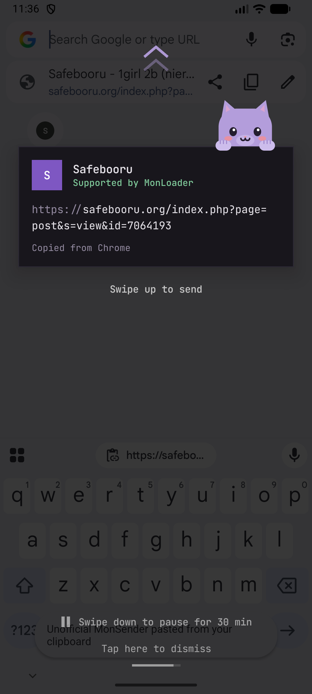
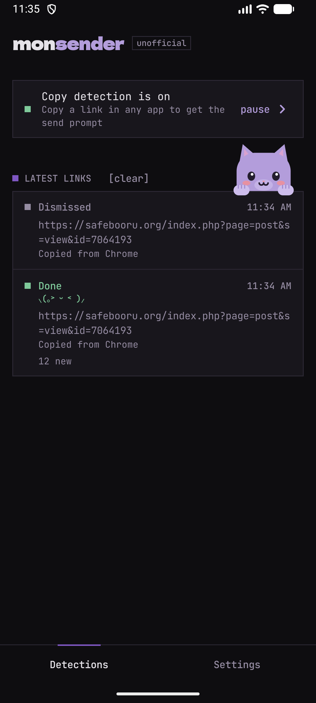
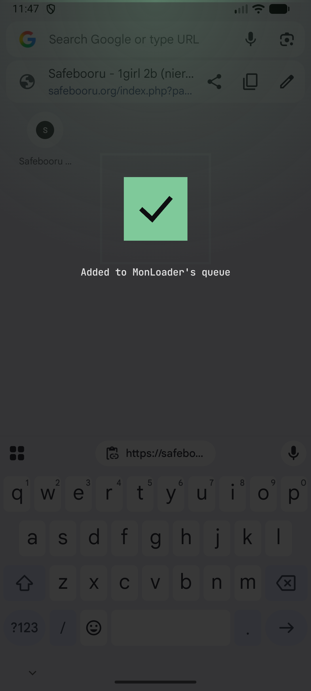
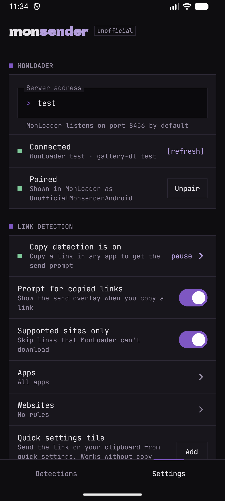

  

 

> [!WARNING]
> This is a prototype. It was vibecoded and **has not been code reviewed**, so neither users nor developers reusing the code should expect a flawless app. **It mainly exists to demonstrate my idea for making downloading to monbooru easier on Android**.
>
> Support is minimal and best effort only.

   

An unofficial Android companion for [MonLoader](https://github.com/monbooru/monloader), inspired by [MonSender](https://github.com/monbooru/monsender). Copy a link in any app, swipe up on the prompt, and it lands in MonLoader's download queue, ready for [monbooru](https://github.com/monbooru/monbooru).

This project is not affiliated with monbooru and is not made or maintained by the monbooru maintainers.

<table align="center">
  <tr>
    <td align="center"> <b>Send prompt</b> Copy a link, swipe up</td>
    <td align="center"> <b>Detections</b> Live MonLoader job status</td>
    <td align="center"> <b>Sent</b> Queued in MonLoader</td>
    <td align="center"> <b>Settings</b> Server, pairing, filters</td>
  </tr>
</table>

Meet **Kitty**, who keeps you company while you collect. She blinks, scratches, licks her paws and meows when you pet her. Pet her a lot and she might come a little closer (=^･ω･^=)

## Install

1. Download the latest APK from [Releases](../../releases).
2. Open it on your phone and allow installing from your browser or file manager when asked.

Requires Android 8.0 or newer.

To get updates automatically, add `https://github.com/IkariDevGIT/UnofficialMonsenderAndroid` to [Obtainium](https://github.com/ImranR98/Obtainium).

## Setup

1. **Server:** enter your MonLoader address, e.g. `http://192.168.1.20:8456`.
2. **Pair:** tap Pair, then approve the request in MonLoader under Settings → Pairing.
3. **Copy detection:** under Link detection, tap Turn on and enable the app's accessibility service.

   On Android 13 and newer, Android may say the setting is restricted. Tap App info, then ⋮ → Allow restricted settings, and turn the service on again.

The quick settings tile and the share menu work without copy detection.

**Just looking around?** Enter `test` as the server address. The app then talks to a built-in pretend MonLoader, so you can pair, send and watch jobs finish without a server.

## Privacy

**No data collection, fully offline.** There are no analytics, no tracking, no crash reporting and no accounts. The app never contacts anything except the MonLoader server you enter yourself, and it only does that to send the links you choose to send.

**What "log" means here.** The *log* is the list on the Detections tab: the last 20 links you sent, with whether they arrived. It's a convenience for you, stored only on your phone, and never uploaded or shared with anyone. Nothing is written to Android's system log either.

- **Only links, ever.** The app reads the clipboard only right after a copy, and only to look for a link. Anything that isn't a link is ignored on the spot and never stored anywhere. Clips marked as sensitive (passwords, one-time codes) aren't read at all.
- **Your filters decide what's logged.** Links from apps you've filtered out, or from sites you've set to never prompt, are never logged. By default every app and site is allowed.
- **Pausing means nothing is read.** Pause copy detection from the status card at the top of the Detections tab, or swipe the prompt down for a quick 30 minutes. While paused, Android doesn't even pass the app the signs of a copy, so the clipboard isn't touched at all. The pause carries on through app and phone restarts and ends by itself when its time is up. Sharing a link to the app and the quick settings tile still work, since you use those on purpose.
- **Don't log, just send.** Turn this on under Settings → Privacy and the app keeps no history at all: links are sent and forgotten, the Detections tab stays empty, and the existing log is deleted. Only your settings are kept.

## Troubleshooting

**Copy detection keeps turning itself off.** Some phones (Samsung, Xiaomi, Huawei, Oppo and others) stop background apps to save battery, which also switches off their accessibility service. Set the app's battery usage to Unrestricted in App info, and on Samsung add it to Never sleeping apps. See [dontkillmyapp.com](https://dontkillmyapp.com) for your phone.

## Planned

- **Send options:** long-press the prompt to pick the monbooru gallery, a folder, extra tags or how many posts a search fetches before sending. A normal swipe keeps the defaults.
- **Outbox:** links wait on your phone and go out on your terms. Hold them until MonLoader is reachable and send them as soon as it is, collect a few and send them together, or send at times you schedule. Nothing gets lost when you're away from home.

## Contributing

Pull requests are welcome as long as you've reviewed them at least a bit.

## License

[0BSD](LICENSE). Bundled assets keep their own licenses: JetBrains Mono and Dela Gothic One under the [SIL Open Font License](app/src/main/assets/licenses), and Kitty's meow from [BigSoundBank](https://bigsoundbank.com) under CC0.
